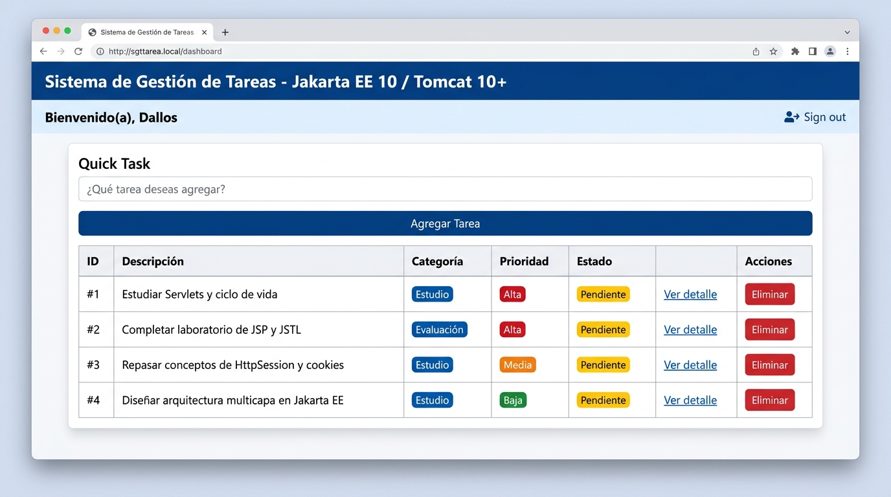
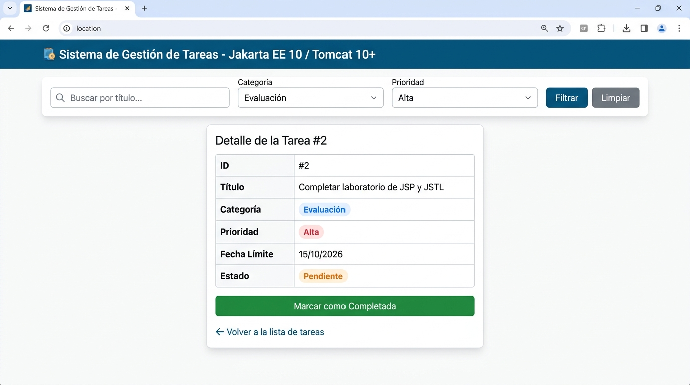

# Post-contenido — Unidad 5: Gestión de Tareas con Servlet, JSP, JSTL y Sesión

**Autor:** Dallos  
**Curso:** Desarrollo Web Empresarial / Arquitectura Java EE  
**Tecnologías:** Java 17, Jakarta Servlet 6.0, Jakarta Server Pages (JSP) 3.0, JSTL 3.0, Apache Tomcat 10+ / 11, Maven 3.9+  

---

## 📋 Descripción del Proyecto

Este repositorio contiene la solución técnica completa de las **Partes 1 y 2** para la **Unidad 5**, implementando una arquitectura web MVC multicapa con **Jakarta EE 10** bajo el contenedor de servlets **Apache Tomcat 10+**.

La aplicación proporciona un sistema integral de **Gestión de Tareas** en memoria que cubre el ciclo de vida completo de peticiones HTTP, separación de responsabilidades entre Controladores (Servlets), Vistas (JSP con JSTL) y Modelos (JavaBeans), gestión avanzada de ámbitos de datos (`applicationScope`, `sessionScope`, `requestScope`), validación en servidor, filtrado reactivo combinado con Java Streams y navegación segura mediante los patrones **Post-Redirect-Get (PRG)** y **Request Forwarding**.

---

## 🚀 Resumen de Implementación

### Parte 1: Arquitectura Base, Ciclo GET/POST, Validación y Patrón PRG
- **Controlador Base (`TareasServlet`):** Manejo del ciclo de peticiones HTTP `GET` para renderizar el listado y `POST` para procesar formularios de inserción rápida (`accion=agregar`) y eliminación (`accion=eliminar`).
- **Validación del Servidor:** Validación exhaustiva de campos obligatorios en el servidor. Si el título está vacío o en blanco, la petición se preserva en `requestScope` con un mensaje de error explicativo y se despacha a la vista sin mutar el modelo.
- **Patrón Post-Redirect-Get (PRG):** Implementación de `resp.sendRedirect(...)` tras operaciones de mutación exitosas (agregar, eliminar, completar), previniendo el reenvío accidental de formularios al refrescar la página (`F5`).
- **Modelo de Dominio JavaBean (`Tarea`):** Encapsulación de propiedades con constructores estándar, serialización y métodos accesores.
- **Vistas con JSTL Core y Functions:** Despliegue de plantillas JSP dinámicas utilizando `${pageContext.request.contextPath}`, tags `<c:forEach>`, `<c:if>`, `<c:choose>`, y funciones como `${fn:length(tareas)}`.

### Parte 2: Filtrado Combinado, Gestión de Ámbitos y Vista de Detalle
- **Modelo Extendido:** Inclusión de atributos `categoria`, `prioridad` ("Alta", "Media", "Baja") y `fechaLimite` (`java.util.Date`).
- **Persistencia en `applicationScope` (`ServletContext`):** Publicación del catálogo maestro de tareas en el contexto global de la aplicación durante `init()`, permitiendo acceso transversal entre múltiples servlets sin duplicar estructuras en memoria.
- **Persistencia de Filtros y Usuario en `sessionScope` (`HttpSession`):** Almacenamiento del identificador de usuario y de los criterios de búsqueda activos (`filtroTexto`, `filtroCategoria`, `filtroPrioridad`) en la sesión HTTP del cliente, manteniendo el estado a lo largo de la navegación.
- **Motor de Filtrado con Java Streams:** Evaluación simultánea y no destructiva de los tres filtros (texto insensible a mayúsculas/minúsculas, categoría exacta y nivel de prioridad) y extracción automática de categorías únicas ordenadas.
- **Servlet y Vista de Detalle (`DetalleTareaServlet` / `detalle.jsp`):** Consulta directa de tareas desde `applicationScope`, despacho vía `RequestDispatcher.forward` con formateo de fechas mediante `<fmt:formatDate value="${tarea.fechaLimite}" pattern="dd/MM/yyyy"/>` y acción para marcar tareas como completadas (`accion=completar`).

---

## 🏛️ Decisiones de Diseño Técnico

### 1. Lista de tareas como variable de instancia y `applicationScope`
> **Justificación:**  
> En una aplicación web basada en Servlets, las instancias de los servlets son creadas y gestionadas por el contenedor (Tomcat) como *singletons* por defecto. Para garantizar que todos los componentes de la aplicación (como `TareasServlet` y `DetalleTareaServlet`) operen sobre la misma fuente de verdad sin instanciar estructuras de datos redundantes ni acoplarse directamente entre sí, la colección `List<Tarea>` se inicializa durante el método de ciclo de vida `init()` y se publica explícitamente en el `ServletContext` (`applicationScope`) mediante `getServletContext().setAttribute("tareas", tareas)`.  
> De este modo, cualquier servlet o filtro puede acceder y modificar el estado global compartido de forma consistente en memoria.

### 2. Uso de `HttpSession` vs `HttpServletRequest` para filtros y usuario
> **Justificación:**  
> La elección del ámbito de almacenamiento responde estrictamente al ciclo de vida y propósito de cada dato:
> - **`HttpSession` (`sessionScope`):** Se utiliza para la identidad del usuario (`usuario`) y las preferencias de filtrado (`filtroTexto`, `filtroCategoria`, `filtroPrioridad`). Estos datos pertenecen a la interacción conversacional del usuario y deben persistir a través de múltiples peticiones independientes, recargas de página y transiciones entre la vista principal y la vista de detalle.
> - **`HttpServletRequest` (`requestScope`):** Se utiliza para la lista resultante de tareas filtradas (`tareas`), la lista calculada de categorías (`categorias`) y los mensajes transitorios de error (`error`). Estos datos son efímeros y específicos de una sola respuesta HTTP; guardarlos en sesión generaría consumo innecesario de memoria en el servidor y posibles inconsistencias de sincronización.

### 3. Uso de `Forward` en el Servlet de Detalle vs Redirección (`PRG`)
> **Justificación:**  
> - **`RequestDispatcher.forward` en `DetalleTareaServlet`:** La visualización del detalle de una tarea es una operación de consulta pura (*lectura idempotente*). Al utilizar `forward`, el servidor transfiere internamente el control y los objetos cargados en memoria (`req.setAttribute("tarea", tarea)`) a `WEB-INF/views/detalle.jsp` en una única transacción HTTP, sin obligar al navegador a realizar un viaje de ida y vuelta adicional (*round-trip*), manteniendo la URL limpia y maximizando la eficiencia.
> - **`sendRedirect` (Patrón PRG) en mutaciones `POST`:** En contraste, las acciones que modifican el estado (`agregar`, `eliminar`, `completar`, `identificar`) deben responder con un código HTTP `302/303 Redirect`. Esto instruye al navegador a ejecutar una nueva petición `GET /tareas`, limpiando los datos del cuerpo de la petición original y evitando duplicaciones accidentales de transacciones si el usuario recarga la página.

### 4. Extracción de estilos a `css/estilos.css`
> **Justificación:**  
> Modularizar las reglas de presentación en un archivo CSS externo desacoplado (`src/main/webapp/css/estilos.css`) respeta el principio de separación de responsabilidades y la regla DRY (*Don't Repeat Yourself*). Permite que tanto `tareas.jsp` como `detalle.jsp` compartan un sistema de diseño consistente (paleta corporativa `#065A82`, tipografía, estilos de badges de prioridad/estado, disposición flexbox para formularios y tablas normalizadas), reduce el tamaño de las respuestas HTML y facilita el almacenamiento en caché del lado del cliente por parte del navegador.

---

## 🛠️ Estructura del Proyecto

```text
dallos-post1-u5/
├── pom.xml
├── README.md
├── img/
│   ├── captura-01.png
│   └── captura-02.png
└── src/
    └── main/
        ├── java/
        │   └── com/
        │       └── ejemplo/
        │           ├── model/
        │           │   └── Tarea.java
        │           └── servlet/
        │               ├── DetalleTareaServlet.java
        │               └── TareasServlet.java
        └── webapp/
            ├── css/
            │   └── estilos.css
            ├── index.jsp
            └── WEB-INF/
                ├── web.xml
                └── views/
                    ├── detalle.jsp
                    └── tareas.jsp
```

---

## ⚙️ Instrucciones de Compilación y Despliegue

### Requisitos Previos
- **Java Development Kit (JDK):** Versión 17 o superior.
- **Apache Maven:** Versión 3.8 o superior.
- **Servidor de Aplicaciones:** Apache Tomcat 10.1+ o Tomcat 11.x (compatible con Jakarta EE 10 / Servlet 6.0).

### 1. Compilación y Empaquetado
Ejecute el siguiente comando en la raíz del proyecto para limpiar y empaquetar el archivo WAR:

```bash
mvn clean package
```

El artefacto generado se ubicará en:
```text
target/gestion-tareas.war
```

### 2. Despliegue en Apache Tomcat 10+
1. Copie el archivo `gestion-tareas.war` dentro del directorio `webapps/` de su instalación local de Tomcat.
2. Inicie el servidor ejecutando `bin/startup.bat` (Windows) o `bin/startup.sh` (Linux/macOS).
3. Abra su navegador web e ingrese a la siguiente URL:
   ```text
   http://localhost:8080/gestion-tareas/
   ```
   *(La aplicación redirigirá automáticamente a `http://localhost:8080/gestion-tareas/tareas` a través de `index.jsp`).*

---

## 📸 Capturas de Pantalla y Checkpoints

### Checkpoint 1 — Parte 1: Listado, Inserción Rápida y Acciones
Vista inicial de la aplicación con la tabla de tareas cargadas en memoria, formulario de inserción rápida validado y botones de acción.



---

### Checkpoint 2 — Parte 2: Filtrado Combinado, Sesión y Vista de Detalle
Vista de la aplicación con filtros combinados activos, usuario identificado en sesión y navegación hacia la vista de detalle con formateo de fechas y botón de completitud.



---

## 📝 Conclusiones de Aprendizaje
- La arquitectura MVC basada en Servlets y JSP en Jakarta EE 10 ofrece un control total y predecible sobre el ciclo de vida de las peticiones HTTP y el manejo de estado en memoria.
- La combinación de `applicationScope` para el catálogo maestro y `sessionScope` para el contexto de usuario/filtros proporciona una experiencia de usuario fluida y reactiva.
- El patrón PRG es esencial en aplicaciones web transaccionales para prevenir duplicidad de datos y garantizar la idempotencia de las operaciones.